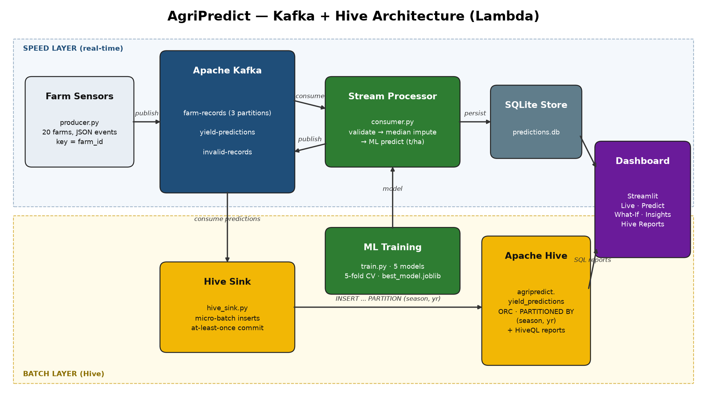

# AgriPredict — Real-time Farm Yield Analytics with Apache Kafka

Kafka-based streaming version of the AgriPredict mini project (paddy rice yield prediction).

## Architecture


```
 [Producer: farm sensors] --> Kafka topic `farm-records` (3 partitions, key=farm_id)
                                   |
                     [Consumer group: agripredict-predictor]
                     validate -> median-impute -> ML model predict
                       |                       |
        topic `yield-predictions`      topic `invalid-records`
                       |
                 SQLite store  -->  Streamlit Dashboard (live, predict, what-if, insights)
```
Layers: **Data** (`data_layer.py`), **Analytics/Orchestration** (`train.py`), **Streaming** (`producer.py`, `consumer.py`), **Presentation** (`dashboard.py`).

ML: Mean Baseline, Linear Regression, Polynomial Ridge, Random Forest, HistGradientBoosting compared via 5-fold CV (MAE); best model saved; permutation importance computed.

## Run with Docker (recommended)
```bash
docker compose up --build
```
- Dashboard: http://localhost:8501
- Kafka UI (topics/messages/consumer lag): http://localhost:8080

## Run locally (without Docker)
```bash
pip install -r requirements.txt
cd src
python data_layer.py && python train.py
# start Kafka on localhost:9092, then in separate terminals:
python consumer.py
python producer.py
streamlit run dashboard.py
```

## No Kafka available? (demo mode)
```bash
cd src && python simulate.py      # in-memory queue simulates the topic
streamlit run dashboard.py
```

## Kafka topics
| Topic | Purpose |
|---|---|
| farm-records | raw streaming farm sensor events |
| yield-predictions | validated events + predicted yield (t/ha) |
| invalid-records | events failing range validation (e.g. pH 14.2) |

## Hive Batch Analytics layer (Lambda architecture)
```
Kafka `yield-predictions` + `invalid-records`
        -> hive_sink.py (consumer group `agripredict-hive-sink`, micro-batches, at-least-once)
        -> Hive table agripredict.yield_predictions  (ORC, PARTITIONED BY season, yr)
        -> hive/reports.sql (HiveQL reports by farm & season)
```
Seasons: **Kharif** (Jun–Oct), **Rabi** (Nov–Mar), **Zaid** (Apr–May).

Reports: `yield_by_farm_season`, `season_summary`, `top_farms`, `irrigation_impact`, `data_quality`.

- Docker: `docker compose up --build` also starts HiveServer2 (port 10000, web UI http://localhost:10002) and the `hive-sink`.
- Run reports: `cd src && python hive_reports.py` (or the **Hive Reports** tab in the dashboard).
- No Hive? `python hive_reports.py --local` runs the same SQL on the local store.
- Beeline: `docker exec -it hive beeline -u jdbc:hive2://localhost:10000 -f /path/reports.sql`
